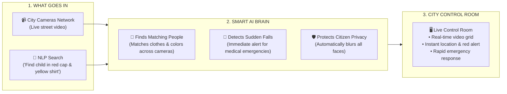

# Sahra-Eye — System Schema (Simple Overview)

A simple, non-technical overview of how the smart vision platform operates.

---

---

## How It Works in 3 Simple Steps:

### Step 1: What Goes In
* **City Cameras Network:** Ingests live video feeds from municipal cameras across the city.
* **NLP Search:** Operators type or speak a plain description (e.g., *"Lost kid in red hat and yellow shirt"*).

### Step 2: What the AI Does
* **Finds Matching People:** Continuously scans all cameras to locate persons matching the description.
* **Detects Medical Emergencies:** Identifies sudden collapses, falls, or cardiac distress in seconds.
* **Protects Citizen Privacy:** Automatically blurs faces so no personal biometric identities are exposed.

### Step 3: What Happens Next
* **City Control Room:** Operators instantly see the target locked on-screen with exact camera location for quick police or ambulance dispatch.
