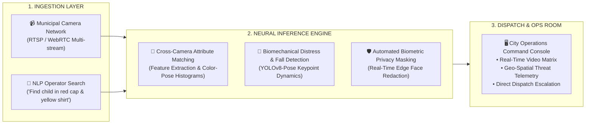

# Sahara Smart 2.0 (Sahra-Eye) 👁️🚨

[](https://github.com/Rib4ko/Sahara-Smart-2.0/actions/workflows/ci-verify.yml)
[](https://www.python.org/)
[](https://fastapi.tiangolo.com)
[](https://github.com/ultralytics/ultralytics)
[](https://opensource.org/licenses/MIT)

> **Next-Generation Autonomous Smart Vision & Emergency Surveillance Core**  
> Developed for rapid city-scale computer vision, missing person NLP localization, automated fall/collapse medical distress response, and privacy-first automated redaction.

---

## 🌟 Key Highlights

- **🎯 Natural Language Target Retrieval (NLP Search):** Instant semantic tracking across camera streams using human attribute queries (e.g., *"Child in red cap and yellow shirt"*).
- **🚨 Instant Medical Emergency Detection:** Real-time pose analysis (`yolov8-pose`) computing fall dynamics, keypoint anomalies, and sudden collapses to dispatch assistance within seconds.
- **🛡️ Privacy-Preserving Architecture:** Automated zero-exposure face blurring at edge inference to safeguard citizen biometric privacy.
- **⚡ High-Throughput Edge Pipeline:** Optimized asynchronous inference supporting Intel OpenVINO runtime acceleration and real-time multi-stream WebRTC/WebSocket feeds.

---

## 📐 Architecture Schema



---

## 🚀 Quickstart Guide

### 1. Prerequisites
- Python 3.10+
- Webcam, RTSP stream, or test video clips
- (Optional) Intel CPU with OpenVINO or NVIDIA CUDA GPU for enhanced acceleration

### 2. Installation

```bash
# Clone repository
git clone https://github.com/Rib4ko/Sahara-Smart-2.0.git
cd Sahara-Smart-2.0

# Create virtual environment
python -m venv venv
# Linux / macOS:
source venv/bin/activate
# Windows:
.\venv\Scripts\activate

# Install dependencies
pip install -r requirements.txt
```

### 3. Running the Engine

Start the FastAPI application with live hot-reload:
```bash
uvicorn app:app --host 0.0.0.0 --port 8000 --reload
```

Access:
- **Interactive API Documentation:** `http://localhost:8000/docs`
- **Health Check & Telemetry Status:** `http://localhost:8000/health`

---

## 🧪 Testing & Verification

Run automated test suite locally:
```bash
pytest test_engine_verify.py -v
# Or run with standard unittest
python -m unittest test_engine_verify.py
```

---

## 🤝 Contributing

Contributions, feedback, and pull requests are welcome!
1. Fork the Project
2. Create your Feature Branch (`git checkout -b feature/AmazingFeature`)
3. Commit your Changes (`git commit -m 'feat: add amazing capability'`)
4. Push to the Branch (`git push origin feature/AmazingFeature`)
5. Open a Pull Request

---

## 📄 License
Distributed under the MIT License. See [LICENSE](LICENSE) for more details.
